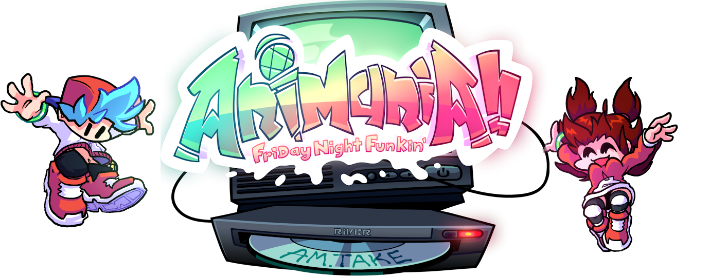
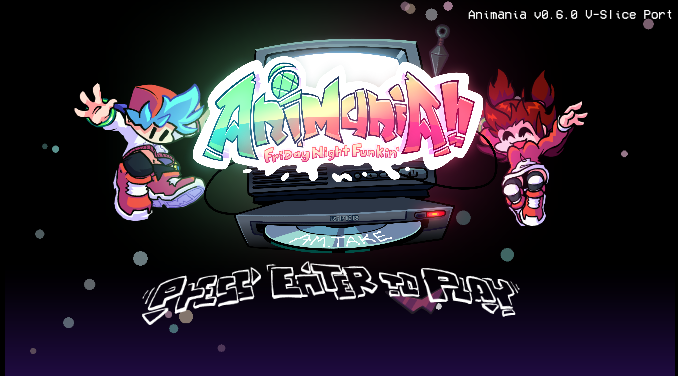
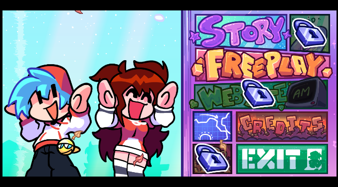
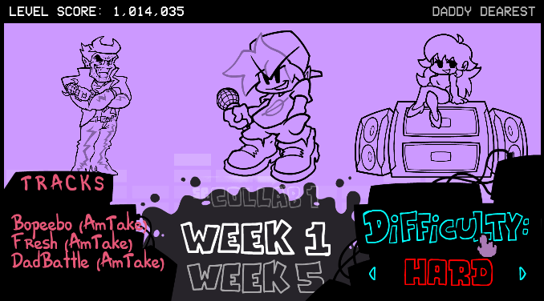

<p align="center">
  
</p>

<h1 align="center">Animania!! — V-Slice Port</h1>

<p align="center">
  A full-featured <b>Friday Night Funkin'</b> mod for the <b>V-Slice</b> engine,<br>
  built entirely with Polymod <code>.hxc</code> scripts — no engine source modifications.
</p>

<p align="center">
  
  
  
</p>

---

## Preview

### Title Screen

The title screen recreated using Polymod's HScript looks 95% identical to the original.

<p align="center">
  
</p>

### Main Menu

A completely redesigned main menu with custom buttons for Story, Freeplay, Website, Credits and Exit.

<p align="center">
  
</p>

### Story Mode

A custom Story Menu with a track list, a difficulty selector, week titles and a level score bar.

<p align="center">
  
</p>

---

## About

**Animania!!** is a Friday Night Funkin' mod originally made on a V-Slice fork, now being ported to **vanilla V-Slice**. Everything — stages, song events, menus, substates and shaders — is implemented through scripted mod content, so the base game stays untouched and the mod can be dropped in like any other.

## Features

- **Custom UI overhaul** — title screen, main menu, story menu, pause menu and game over screen
- **Scripted stages** — including Christmas mall variants and ports from other engines
- **Custom song events** — camera bop, camera angle / lock-on, ghost characters, cinematics and more
- **Healthbar skins** and strumline customization
- **Subtitle system** with multiple visual styles
- **Performance options** and asset precaching aimed at low-end hardware
- **Mobile-friendly** menus with touch support
- **100% mod scripts** — written with Polymod's HScript / `.hxc` scripted classes

> Some menu entries (Story, Website, a few extras) are locked in the current build and will unlock in future versions.
> The News menu Coming Soon...

## Requirements

| Requirement | Version |
| ----------- | ------- |
| Friday Night Funkin' (V-Slice) | `0.8.6` |

## Installation

1. Download the latest release from the [Releases](../../releases) page.
2. Extract the mod folder into your game's `mods/` directory:
   ```
   Funkin/
   └── mods/
       └── animania/
   ```
3. Launch the game. The mod loads automatically through Polymod.

### If You Are on Mobile (Android)

1. Download the latest release from the [Releases](../../releases) page.
2. Open FNF, go to the options, and press "Open Data Folder".
3. Find the mod in your phone's downloads and open it.
4. Select the single folder, tap the three dots in the top-right corner, and tap "Extract to..."
5. Once you've extracted it from the zip file, just swipe right and scroll down until you find the game folder (it will say something like "FNF Data folder").
6. Just go to the "mods" folder and click on "extract here" or "extract"
7. Just exit that screen, and the game will reload the assets and load the mod. Otherwise, restart FNF.

### If You Are on iOS

Pls check this [Gamebanana_Tutorial](https://gamebanana.com/tuts/18921)

## Credits

- **Original game:** [Friday Night Funkin'](https://github.com/FunkinCrew/Funkin) by The Funkin' Crew Inc.
- **Mod:** [AnimaniaCrew'](https://x.com/AnimaniaCrew) Original Mod

---

<p align="center">
  <sub>Animania!! is a fan-made mod and is not affiliated with or endorsed by Funkin' Crew Inc.</sub>
</p>
